  Full-stack developer from São Paulo, Brazil. 
  I build web and mobile products end to end, from the Postgres schema to the screen, mostly in TypeScript.

  
  
  
  
  
  
  
  

### Selected work

- [**soma**](https://github.com/Alyxson/soma): the system behind Soma, by Grupo VIR. Next.js, Prisma, Zod, Tailwind.
- [**Url-Shortener**](https://github.com/Alyxson/Url-Shortener): a REST API to shorten links. TypeScript, Express, MongoDB, Jest.
- [**Weather-GraphQL**](https://github.com/Alyxson/Weather-GraphQL): a weather GraphQL API with a Redis cache in front.
- [**Task-Management-App**](https://github.com/Alyxson/Task-Management-App): tasks for people and teams. Express, PostgreSQL, Jest.

  <picture>
    <source media="(prefers-color-scheme: dark)" srcset="profile/stats-dark.svg">
    
  </picture>
  <picture>
    <source media="(prefers-color-scheme: dark)" srcset="profile/langs-dark.svg">
    
  </picture>

